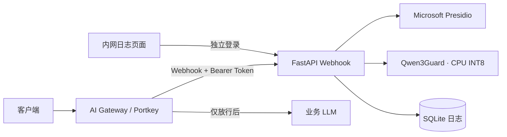

# PANW AI Gateway Local Guardrail

**在自己的 Linux 主机运行 Qwen3Guard + Microsoft Presidio，并通过 Webhook 为 AI Gateway 增加内容检查与中文 PII 检测。**


[English](docs/README.en.md) · [SCM / Portkey 配置](docs/gateway-integration.md) · [API](docs/api.md) · [运维](docs/operations.md) · [限制与安全](docs/limitations.md) · [版本说明](CHANGELOG.md)

## 能做什么

- **CPU-only 推理**：Qwen3Guard-Gen-0.6B，Linear 动态 INT8；不依赖 NVIDIA GPU。
- **内容分类**：只放行 `Safe`；`Unsafe`、`Controversial` 和检测到的 PII 均阻断。
- **中文 PII**：手机号、带日期及校验码验证的 18 位身份证号、邮箱；使用 Presidio 自定义识别器。
- **Webhook**：支持 Portkey 风格的 `beforeRequestHook` / `afterRequestHook`，返回布尔 `verdict` 和 `data`。
- **私有日志页面**：SQLite 持久化、独立登录 Token、筛选、搜索、分页、10 秒刷新、SGT / UTC 切换。
- **有来源的详情**：保留消息角色、顺序、重复项、模型参数、检查耗时和 Trace ID 关联；区分网关快照、Qwen 检测输入及未观测的送达阶段。
- **离线运行模型**：安装时下载固定 revision，校验权重 SHA-256；推理时只读挂载并离线加载。

本项目是独立社区集成，不包含 PANW / Portkey 网关软件，不管理 SCM 账户，也不自动修改防火墙或网关信任列表。

## 先了解边界

**这不是“所有提示注入都能拦截”的保证。** 0.6B 分类模型存在误判和漏检，测试中曾出现纯数字误判及间接提示注入漏检。规则型 PII 也不能覆盖所有姓名、地址或格式变体。请阅读 [限制与安全](docs/limitations.md)。

**流式输入可检查，流式输出不保证先检查后展示。** 输入会在模型生成前检查；生成完才触发的输出检查无法撤回已流给客户端的 token。需要输出严格拦截时，使用非流式请求，或在网关明确实现完整响应缓冲。

## 架构



默认地址：Webhook `127.0.0.1:18080`，Qwen `127.0.0.1:18081`，Presidio `127.0.0.1:18082`。模型与 PII 服务不提供跨主机认证入口，应保持回环监听。

## 环境要求

- Linux x86_64，推荐 Ubuntu 24.04；Docker Engine 与带 `--wait` 支持的 Docker Compose。
- 建议至少 4 个 CPU 线程、8 GB RAM、15 GB 可用磁盘；实际开销随输入长度和并发变化。
- 安装阶段能访问 Docker Hub、PyTorch CPU wheel 源、PyPI 与 Hugging Face。
- 容器使用 Linux **host 网络**，不适用于直接照搬到 Windows / macOS Docker Desktop 的默认网络模式。

验证环境为 Ubuntu 24.04 / 4 vCPU / 8 GB。模型权重约 1.50 GB；短样本分类通常约 1–3 秒，这不是延迟 SLA。首次构建及模型下载可能需要较长时间。

Docker 的官方安装说明见 [Docker Engine on Ubuntu](https://docs.docker.com/engine/install/ubuntu/)。不要为运行本项目关闭现有安全策略或向公网开放端口。

## 快速开始

以下命令在 Linux 主机执行；选择一个普通用户可管理的目录。若使用 `/opt/local-guardrail`，先由管理员创建并授权该目录。

```bash
git clone https://github.com/royhxm/panw-ai-gateway-local-guardrail.git
cd panw-ai-gateway-local-guardrail
git checkout v0.1.0

# 生成 .env；已存在时保留，不覆盖凭据
python3 scripts/setup.py

# 下载固定 revision 并校验模型权重
python3 scripts/download_model.py

# 数据目录仅供容器 UID 10001 访问；不要 chmod 777
sudo chown -R 10001:10001 logs-data model-cache

docker compose config --quiet
docker compose build
docker compose up -d --wait --wait-timeout 180
docker compose ps
curl --noproxy '*' http://127.0.0.1:18080/health
```

如果 Docker 命令需要管理员权限，使用 `sudo docker ...`；不要为了本项目随意扩大系统用户的 Docker 权限。

`scripts/setup.py` 为 `WEBHOOK_TOKEN` 与 `LOGS_TOKEN` 分别生成随机值，不打印它们。请在自己的终端查看 `.env`，将它们放入需要的位置；不要上传这个文件。

需要让**其他内网主机**上的网关访问时，编辑 `.env`：

```dotenv
# 替换为这台 Linux 主机实际拥有的私网 IPv4 地址
WEBHOOK_BIND_HOST=10.20.0.10
```

随后 `docker compose up -d --no-deps --wait webhook`。先验证网关主机/容器到该 IP 的路由；不要直接使用 `0.0.0.0` 或公网地址解决连通性问题。项目不会自动修改任何安全策略。

## 发起一次检测

从 `.env` 取得 `WEBHOOK_TOKEN` 后，在当前终端设置变量；以下占位符必须替换：

```bash
export WEBHOOK_TOKEN='<your-webhook-token>'
curl --noproxy '*' http://127.0.0.1:18080/webhook/portkey \
  -H "Authorization: Bearer $WEBHOOK_TOKEN" \
  -H 'Content-Type: application/json' \
  --data-binary @examples/before-request.json
```

放行响应示意：

```json
{
  "verdict": true,
  "data": {
    "action": "allow",
    "pii": [],
    "safety": {"label": "Safe", "categories": "None", "seconds": 1.5},
    "eventType": "beforeRequestHook"
  }
}
```

`seconds` 为实际模型耗时，示例数字不代表固定值。检测到违规时仍可返回 HTTP 200，但 `verdict:false`；依赖不可用时返回 503。**网关必须同时配置 Deny on Failure 和 Webhook fail-on-error**，才能对这两类失败执行阻断。

## 查看日志

打开 `http://127.0.0.1:18080/logs`，或配置的内网 IP，使用 **LOGS_TOKEN** 登录。它与 Webhook 调用 Token 分开管理。

每条记录可展开三个视图：

1. **请求链路与判定**：哪些阶段被观测、哪些阶段缺少证据；模型分类、PII 命中和分项耗时。
2. **消息与内容对照**：`system` / `user` / `assistant` / `tool` 分开显示，本轮用户输入、历史消息、重复项及检测模型输入分别标注。
3. **Webhook 原始快照**：保留网关 JSON 的字段结构，移除凭据字段，并遮盖 Presidio 检出的 PII。

日志保存最近 30 天、最多 10,000 条；清理在新记录写入时执行。**摘要里的遮盖仅发生在日志副本，不表示已经修改发送给业务 LLM 的内容。** 详情不把 Webhook 放行当作 LLM 已接收，也不会用下一轮历史中的助手消息伪造上一轮输出快照。

## 接入 PANW AI Gateway / SCM

Webhook 检查填写：

- URL：`http://<private-webhook-host>:18080/webhook/panw`。
- Headers：`{"Authorization":"Bearer <WEBHOOK_TOKEN>","Content-Type":"application/json"}`。
- Timeout：`95000` 毫秒。
- **Fail if non-200 or timeout**：开启。
- **Deny on Failure**：开启；**Run Asynchronously** 和 **Soft deny**：关闭。
- Forward Headers：可显式转发 `x-portkey-trace-id`；不要转发调用者的 Authorization。

保存 Guardrail，将其关联到所需路由的输入/输出检查，再从 SCM 提交下发。按产品版本核对 UI 和功能可用性。本项目曾与 PANW AI Gateway Enterprise **2.33.1** 的 Portkey 风格 Webhook 契约完成实际连通性验证；不承诺所有 PANW 产品版本具备相同界面。

如果出现 `webhookURL rejected by SSRF policy`，应按网关管理员审批流程，将**准确的 Webhook 私网主机**加入网关 `TRUSTED_CUSTOM_HOSTS`，保留已有条目。不能禁用 SSRF 防护或加入全网通配符。完整步骤和代理请求注意事项见 [网关接入文档](docs/gateway-integration.md)。

## 验证与开发

```bash
# 对运行中的完整栈执行真实检查；会创建测试日志
python3 scripts/smoke_test.py

# 在独立 Python 3.11 环境运行不下载模型权重的测试
python3 -m venv .venv
. .venv/bin/activate
pip install -r requirements-test.txt
pytest

# 如需运行实际 Presidio 识别器测试，再安装运行依赖
pip install -r requirements.txt
pytest
```

轻量测试会跳过需要 Presidio 的测试；CI 安装完整运行依赖并执行它们。模型服务由完整栈 smoke test 验证，不能用 mock 测试证明模型检测率。

## 文档与目录

- `app/`：模型、PII、Webhook、日志与前端。
- `scripts/`：安全初始化、固定模型下载、运行中 smoke test。
- `examples/`：仅合成数据的请求和网关配置模板。
- `tests/`：鉴权、日志保密、角色/来源、故障阻断、PII 识别器等回归测试。
- [API 约定](docs/api.md)、[运行与升级](docs/operations.md)、[已知限制](docs/limitations.md)、[版本记录](CHANGELOG.md)。

应用代码使用 MIT；第三方模型和组件遵循各自许可证，见 [NOTICE](NOTICE.md)。仓库不包含模型权重、业务凭据、真实用户日志或 PANW 网关镜像。

